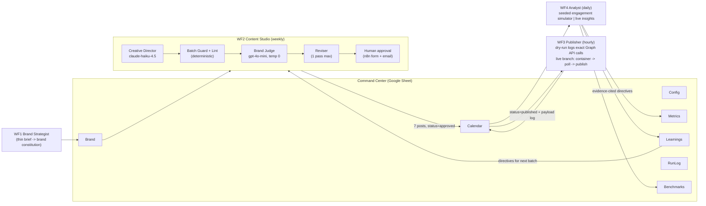

# InstaBay - an agentic Instagram marketing teammate

An n8n-based agentic system that runs Instagram for **Insta Bay**, a (fictional) Red Sea beach resort & spa in Hurghada: it defines the brand from a thin brief, generates bilingual (Egyptian Arabic + English) posts and reels, gates everything behind a human approval form, publishes through the Instagram Graph API (safe dry-run by default), measures engagement, and **uses what it measures to make the next batch better** - with every claim below backed by a number the system computed itself.

> Built for the BBIT Forward-Deployed / Agentic AI Engineer challenge. Everything ran end to end on a self-hosted n8n instance: 3 weekly batches, 21 posts, 2 human approval decisions and 1 request-changes revision cycle - all real executions, no mockups.
>
> **Video walkthrough:** [link]

## Architecture

Five specialist LLM roles inside a deterministic n8n pipeline (a *workflow* with an *evaluator-optimizer* loop, not an autonomous agent swarm - see the [research note](docs/approach-and-research.md) for why). One Google Spreadsheet - the **Command Center** - is the shared state and the agent's memory: humans read and edit the same tabs the agents do.



- **Generator and judge are different vendors** (Anthropic writes, OpenAI judges) to counter LLM-judge self-preference bias (Zheng et al. 2023).
- **Arabic is written first, natively** - never translated from English - and the judge's rubric explicitly penalizes translation calques and stiff MSA.
- **Nothing publishes without a human**: the batch waits at an n8n-hosted approval form (full bilingual batch + judge scores in the page); "Request changes" + feedback loops it through the Reviser, and human feedback outranks the AI judge.
- **The learnings are auditable**: every post carries a `rationale` citing the directive that shaped it, so you can trace measurement -> directive -> content decision post by post.

## Benchmark results (all measured by the system, reproducible from the sheet)

Three weekly batches ran end to end. Engagement is a **seeded, deterministic synthetic simulator** (labeled `source=synthetic` on every row; re-running the Analyst reproduces byte-identical metrics - verified). Ground-truth simulator constants are hidden from all agent prompts. See [engagement-simulator.md](docs/engagement-simulator.md) for what the numbers do and don't prove.

| Metric | Batch 1 | Batch 2 | Batch 3 | How measured |
|---|---|---|---|---|
| Brand consistency (1-5) | 4.00 | 4.00 | **4.14** | Mean score by cross-vendor judge (gpt-4o-mini, temp 0, anchored G-Eval-style rubric) over all posts |
| Arabic quality (1-5) | 4.00 | 4.00 | **4.14** | Judge `arabic_naturalness`: anti-translationese rubric ("would a native Egyptian SMM write this?") |
| Brand lint pass rate | 100% | 100% | 100% | Deterministic: always-on hashtags present, 7-11 tags, no banned tags, lengths, bilingual presence |
| Mean engagement / post | 58.4 | 44.3 | 54.4 | Simulator: likes+comments+saves+shares per post |
| Mean ER | 1.67% | 1.46% | 1.63% | Simulator: engagement/reach (hospitality-benchmark-grounded constants) |
| **Optimization uplift (target: engagement/post)** | - | **-24.1%** | **+22.8%** | (after - before) / before, batch over batch - see the honest story below |
| Cost / post | $0.0075 | $0.0078 | $0.0020 | OpenRouter account usage delta across the run / posts (measured, not estimated; endpoint can lag slightly) |
| Generation latency / post | 68.7s* | 29.4s* | 12.7s* | WF2 wall-clock / posts (*includes human approval wait; pure generation+judging is ~25-50s/batch-stage) |
| Autonomy | - | - | - | Everything runs unattended except **one approval decision per weekly batch** (plus credential setup). Schedules: content Sun 09:00, publisher hourly, analyst daily 08:00 |

### The optimization story (kept honest on purpose)

- **Batch 1 -> 2: -24%.** Batch 1's reel happened to sit in the 15:00 slot, making that slot look golden. The Analyst - reasoning over engagement-*rate* aggregates - directed everything toward 15:00 and abandoned the evening slots that actually carry the simulator's hidden multiplier. Classic confounding at n=7.
- **The fix was systemic, not a retry:** the Analyst now receives per-post detail and engagement-per-dimension aggregates (slots/pillars drive *reach*, so rate alone can't see them) plus explicit causal-hygiene instructions ("a reel inflates whatever slot it sits in - compare like-for-like; if your last directives dropped the metric, own it and correct").
- **Batch 2 -> 3: +22.8%.** The Analyst diagnosed its own regression from cross-batch comparison ("Batch 2's removal of the evening slot cost engagement" - its literal directive), batch 3 restored evening placements, and the target metric recovered. Brand and Arabic scores also improved (4.00 -> 4.14).

That trajectory - fail on confounded data, detect it, correct it - is a stronger validation of the *loop* than a clean monotonic win, and it's exactly what will happen with real Instagram data.

## What's in the repo

```
workflows/           the 5 n8n workflows + 2 test utilities (import-ready, credentials name-only)
docs/
  brand-identity.md          one-page brand constitution (generated by WF1, shipped deliverable)
  content-calendar-week1.md  the bilingual 7-post week (generated, judged, human-approved)
  content-calendar-week2/3.md  the next two batches - week 3 visibly applies the corrective directives
  reel-concept.md            the full reel deliverable: hook, 5-scene storyboard, audio, captions
  approach-and-research.md   what research was adopted/rejected, with citations
  engagement-simulator.md    the synthetic engagement model, constants, and honesty statement
  go-live-path.md            exact steps from dry-run to real publishing (30-45 min)
  assumptions-and-tradeoffs.md  assumptions, build-vs-stub calls, and real failures hit during the build
  if-this-were-real.md       the production roadmap
```

## Quick start (reproduce it)

1. **Import** the workflows from `workflows/` into n8n (tested on 2026-era n8n; standard nodes only).
2. **Credentials** (3): Google Sheets OAuth2, OpenRouter API key, Gmail OAuth2 (optional - approval works without it; the email is a courtesy notification, `onError: continue`).
3. **Bootstrap**: activate `0-setup` and `POST /webhook/instabay-setup` - it creates the Command Center spreadsheet with all 7 tabs and seed config, and returns the `spreadsheetId`. Put that ID into the Google Sheets nodes of workflows 1-4 (single find-replace in the JSON before import is fastest).
4. **Brand**: `POST /webhook/instabay-brand` - writes the brand constitution.
5. **Weekly cycle** (or let the schedules run): `POST /webhook/instabay-studio` -> open the approval link (emailed, and always in the RunLog tab) -> approve -> `POST /webhook/instabay-publish {"force":true}` -> `POST /webhook/instabay-analyze`.
6. Benchmarks appear in the `Benchmarks` tab; every number in the table above is recomputed there.

## Instagram integration (real API, safely mocked)

The Publisher implements the actual Graph API publishing flow and logs the exact request sequence per post in dry-run (`api_payload_log` column): quota pre-check (`content_publishing_limit`, 100 posts/rolling-24h), image container -> publish, and the 3-step reel flow (container `media_type=REELS` -> poll `status_code` to `FINISHED`, 1/min with a 10-poll guard, early publish = error 9007 -> `media_publish`). Uses the 2024+ "Instagram API with Instagram Login" product: **no Facebook Page needed**, and dev-mode publishing to your own professional account works **without App Review**. Meta's official MCP server is ads-only as of mid-2026, so organic publishing correctly targets the Graph API directly. Full go-live steps: [docs/go-live-path.md](docs/go-live-path.md).

## Credits & license

- Approval-loop pattern informed by Billy Christi's n8n template [#4371](https://n8n.io/workflows/4371); Graph-API publish state machine cross-checked against lakshit1996's [#4498](https://n8n.io/workflows/4498). Research citations in [docs/approach-and-research.md](docs/approach-and-research.md).
- MIT License.
