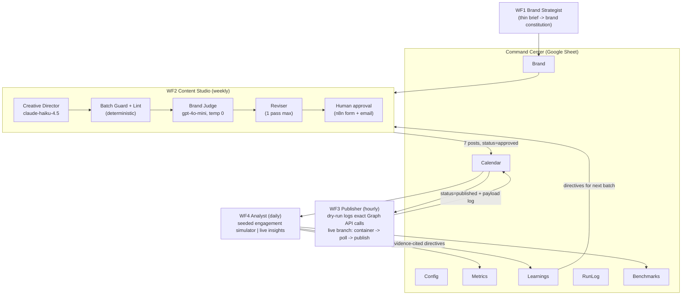

# InstaBay - an agentic Instagram marketing teammate

## Project status and evidence

**Tested reference.** Instagram publishing was a dry run. The resort and engagement data are fictional/synthetic, not a customer account.

**My contribution:** Implemented bilingual drafting, an independent cross-model judge, approval gates, dry-run publishing payloads and an analyst feedback loop.

**Verification:** Historical recorded tests: eight batches and 56 generated posts; deterministic synthetic engagement.


An agentic n8n reference system that simulates an Instagram content workflow for Insta Bay, a (fictional) Red Sea beach resort & spa in Hurghada, from brand definition to bilingual content, human approval, Instagram Graph API publishing, and measurement that improves the next batch.


> Built for the BBIT Forward-Deployed / Agentic AI Engineer challenge. The local/public artifacts document three batches; later recorded deployment tests covered eight batches / 56 generated posts. Publishing stayed in dry-run and engagement was synthetic. These are tests, not a live customer campaign.
>


## The problem

Running a resort's Instagram means a constant stream of on-brand, bilingual content that has to be planned, written, approved, published on schedule, and then measured, week after week. For a property without a full social media team, that is heavy, repetitive manual work, and quality drifts as volume grows. InstaBay treats the entire loop as one system, so a single person steers it instead of running every step by hand.

## What it does

- Turns a thin brief into a one-page brand constitution that everything downstream is generated against.
- Generates bilingual (Egyptian Arabic + English) posts and reels weekly, with Arabic written first, natively, never translated from English.
- Runs a cross-vendor quality gate: Anthropic generates, a deterministic lint enforces the brand rules, and OpenAI judges, with one revision pass on a fail.
- Gates every batch behind a human approval form; "Request changes" plus feedback loops it back through the reviser, and human feedback outranks the AI judge.
- Publishes through the Instagram Graph API, safe dry-run by default, and logs the exact request sequence per post.
- Measures engagement and turns it into evidence-cited directives that make the next batch better, closing the loop.

## Architecture

Five specialist LLM roles inside a deterministic n8n pipeline (a *workflow* with an *evaluator-optimizer* loop, not an autonomous agent swarm - see the [research note](docs/approach-and-research.md) for why). One Google Spreadsheet - the **Command Center** - is the shared state and the agent's memory: humans read and edit the same tabs the agents do.



- **Generator and judge are different vendors** (Anthropic writes, OpenAI judges) to counter LLM-judge self-preference bias (Zheng et al. 2023).
- **Arabic is written first, natively** - never translated from English - and the judge's rubric explicitly penalizes translation calques and stiff MSA.
- **Nothing publishes without a human**: the batch waits at an n8n-hosted approval form (full bilingual batch + judge scores in the page); "Request changes" + feedback loops it through the Reviser, and human feedback outranks the AI judge.
- **The learnings are auditable**: every post carries a `rationale` citing the directive that shaped it, so you can trace measurement -> directive -> content decision post by post.

## Stack

- **n8n** (self-hosted) - orchestration of the five workflows and the human approval form.
- **Anthropic claude-haiku-4.5** - the Creative Director that generates the bilingual content.
- **OpenAI gpt-4o-mini** (temp 0) - the cross-vendor Brand Judge.
- **OpenRouter** - model routing and per-post cost accounting.
- **Google Sheets** - the Command Center: shared state, memory, and benchmarks.
- **Gmail** (optional) - approval notification emails.
- **Instagram Graph API** - organic publishing (dry-run by default, live branch ready).

## Benchmark results (all measured by the system, reproducible from the sheet)

Three weekly batches ran end to end. Engagement is a **seeded, deterministic synthetic simulator** (labeled `source=synthetic` on every row; re-running the Analyst reproduces byte-identical metrics - verified). Ground-truth simulator constants are hidden from all agent prompts. See [engagement-simulator.md](docs/engagement-simulator.md) for what the numbers do and don't prove.

Synthetic engagement measurements are described in the simulator documentation; they are not real audience results.

### What the simulation tests

The seeded simulator exercises feedback, revision and reproducibility. Its measurements are synthetic and do not predict engagement on a real account.

## What's in the repo

```
workflows/           the 5 n8n workflows + 2 test utilities (import-ready, credentials name-only)
docs/
  brand-identity.md          one-page brand constitution (generated by WF1, shipped deliverable)
  content-calendar-week1.md  the bilingual 7-post week (generated, judged, human-approved)
  content-calendar-week2/3.md  the next two batches - week 3 visibly applies the corrective directives
  reel-concept.md            the full reel deliverable: hook, 5-scene storyboard, audio, captions
  approach-and-research.md   what research was adopted/rejected, with citations
  engagement-simulator.md    the synthetic engagement model, constants, and honesty statement
  go-live-path.md            exact steps from dry-run to real publishing (30-45 min)
  assumptions-and-tradeoffs.md  assumptions, build-vs-stub calls, and real failures hit during the build
  if-this-were-real.md       the production roadmap
```

## Quick start (reproduce it)

1. **Import** the workflows from `workflows/` into n8n (tested on 2026-era n8n; standard nodes only).
2. **Credentials** (3): Google Sheets OAuth2, OpenRouter API key, Gmail OAuth2 (optional - approval works without it; the email is a courtesy notification, `onError: continue`).
3. **Bootstrap**: activate `0-setup` and `POST /webhook/instabay-setup` - it creates the Command Center spreadsheet with all 7 tabs and seed config, and returns the `spreadsheetId`. Put that ID into the Google Sheets nodes of workflows 1-4 (single find-replace in the JSON before import is fastest).
4. **Brand**: `POST /webhook/instabay-brand` - writes the brand constitution.
5. **Weekly cycle** (or let the schedules run): `POST /webhook/instabay-studio` -> open the approval link (emailed, and always in the RunLog tab) -> approve -> `POST /webhook/instabay-publish {"force":true}` -> `POST /webhook/instabay-analyze`.
6. Benchmarks appear in the `Benchmarks` tab; every number in the table above is recomputed there.

## Instagram integration (real API, safely mocked)

The Publisher implements the actual Graph API publishing flow and logs the exact request sequence per post in dry-run (`api_payload_log` column): quota pre-check (`content_publishing_limit`, 100 posts/rolling-24h), image container -> publish, and the 3-step reel flow (container `media_type=REELS` -> poll `status_code` to `FINISHED`, 1/min with a 10-poll guard, early publish = error 9007 -> `media_publish`). Uses the 2024+ "Instagram API with Instagram Login" product: **no Facebook Page needed**, and dev-mode publishing to your own professional account works **without App Review**. Meta's official MCP server is ads-only as of mid-2026, so organic publishing correctly targets the Graph API directly. Full go-live steps: [docs/go-live-path.md](docs/go-live-path.md).

## Credits

Approval-loop pattern informed by Billy Christi's n8n template [#4371](https://n8n.io/workflows/4371); Graph-API publish state machine cross-checked against lakshit1996's [#4498](https://n8n.io/workflows/4498). Research citations in [docs/approach-and-research.md](docs/approach-and-research.md).

## License

Released under the MIT License. See [LICENSE](LICENSE).
